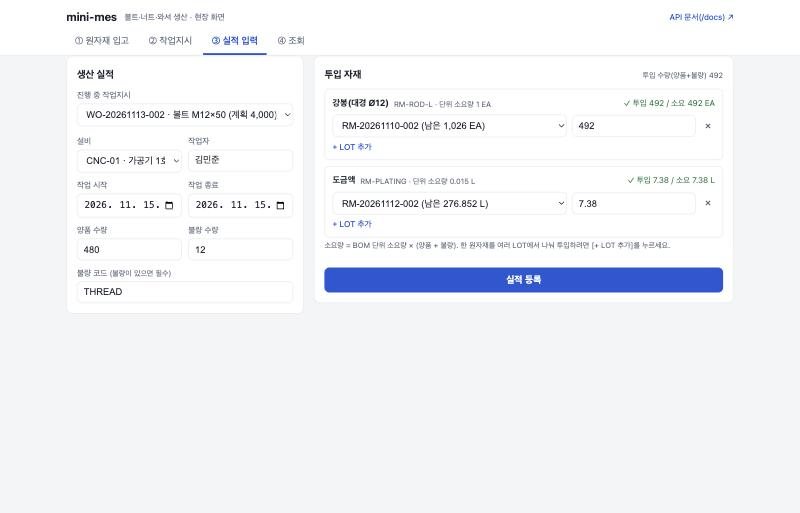
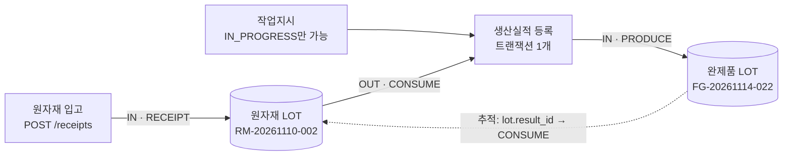
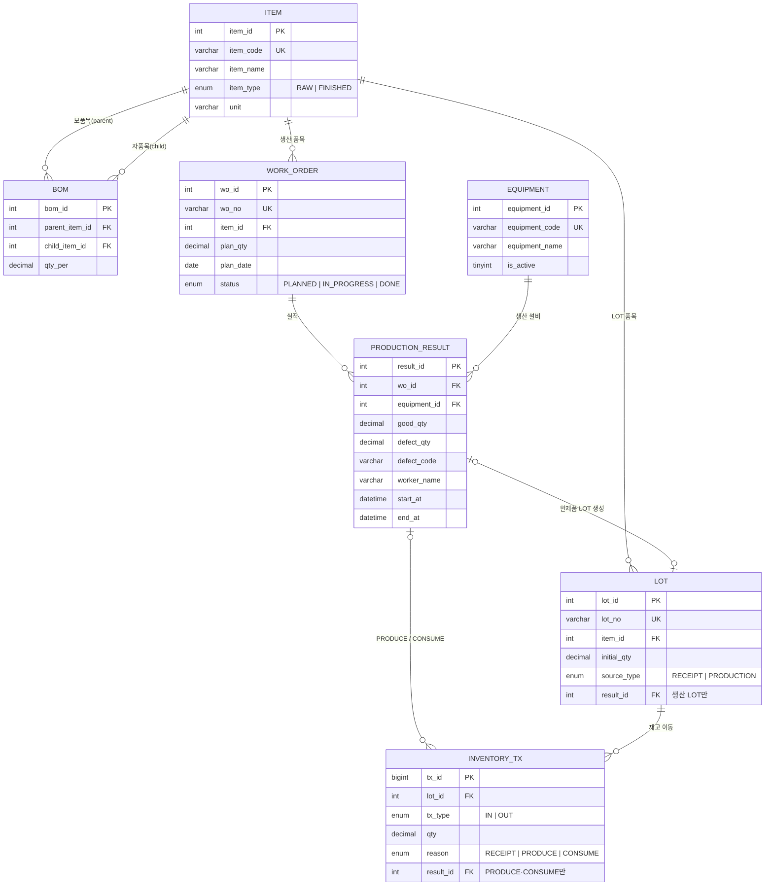
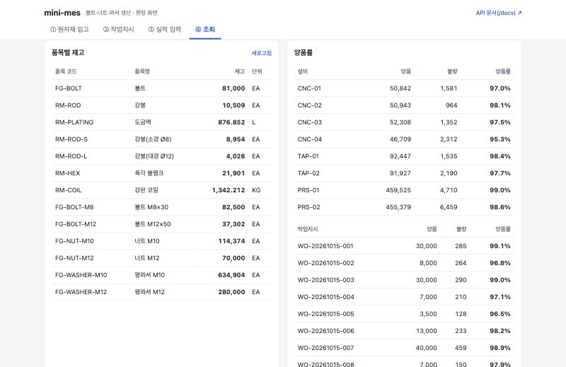
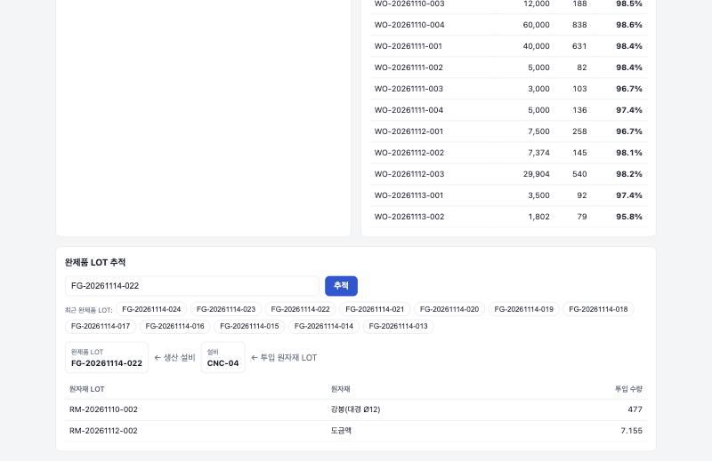

# mini-mes — 백엔드 개발자가 직접 만든 초미니 MES

> **완제품 LOT 하나를 원자재 LOT까지 거슬러 올라가는 MES를 직접 설계하고 구현했습니다.**
> 기준정보 · 작업지시 · 생산실적 · LOT 추적 · 재고 원장. MES의 다섯 가지 기본 개념을 **테이블 7개와 REST API 15개**로 만들고, 직원 100여 명 공장의 **한 달 운영 시뮬레이션**으로 검증했습니다.



| 테이블 | REST API | 자동 테스트 | 한 달 시뮬레이션 | 정합성 검사 |
| :---: | :---: | :---: | :---: | :---: |
| **7** | **15** | **45** | 실적 **762**건 · 재고 이동 **2,385**건 | **10 / 10** 통과 |

`Python 3.12` `FastAPI` `Pydantic v2` `SQLAlchemy 2 Core (text()만, ORM 미사용)` `MariaDB 11` `pytest` `Docker Compose` `HTML + fetch`

---

## 목차

1. [왜 만들었나](#1-왜-만들었나)
2. [MES 개념을 테이블로](#2-mes-개념을-테이블로)
3. [데이터 흐름과 ERD](#3-데이터-흐름과-erd)
4. [핵심 설계 결정](#4-핵심-설계-결정)
5. [실적 등록 트랜잭션](#5-실적-등록-트랜잭션)
6. [현장 화면](#6-현장-화면)
7. [검증](#7-검증)
8. [한 달 운영 시뮬레이션](#8-한-달-운영-시뮬레이션)
9. [개발 과정: 단계별 커밋](#9-개발-과정-단계별-커밋)
10. [실행 방법](#10-실행-방법)
11. [테스트 시나리오와 정답](#11-테스트-시나리오와-정답)
12. [API 명세](#12-api-명세)
13. [폴더 구조](#13-폴더-구조)
14. [배운 것, 한계, 확장 계획](#14-배운-것-한계-확장-계획)

---

## 1. 왜 만들었나

저는 백엔드 개발자입니다. 트랜잭션과 데이터 정합성은 익숙했지만 **제조 현장의 언어는 처음**이었습니다.

- 작업지시와 생산실적은 무엇이 다른가?
- 왜 모든 제품에 LOT 번호가 붙는가?
- 재고는 어디서, 어떻게 계산되는가?
- 불량품이 나오면 원자재 장부는 어떻게 되는가?

개념을 읽는 것보다 **직접 테이블을 설계하고, 실적 한 건이 등록될 때 어떤 행이 생기는지 따라가 보는 편이 빨리 이해된다**고 판단했습니다. 그래서 "데이터가 어디서 생기고 어디로 흐르는지 SQL 수준에서 설명할 수 있게 한다"를 목표로 이 프로젝트를 시작했습니다.

**범위는 의도적으로 좁혔습니다.** 볼트 가공 라인 하나(원자재 2종, 설비 2대, 완제품 1종)에서 시작하고 ERP·PLC 연동·다중 공정·로그인은 제외했습니다. 그 대신 남은 핵심을 끝까지 정확하게 구현하고, 모든 규칙을 테스트로 증명하는 데 집중했습니다.

---

## 2. MES 개념을 테이블로

| MES 개념 | 테이블 | 이 프로젝트에서 하는 일 |
| --- | --- | --- |
| **기준정보** | `item` `bom` `equipment` | 품목(원자재·완제품), 자재명세(볼트 1EA = 강봉 1EA + 도금액 0.01L), 설비. 거의 변하지 않는 마스터 데이터 |
| **작업지시** | `work_order` | ERP에서 내려온 생산계획. `PLANNED → IN_PROGRESS → DONE` 상태 전이를 API가 강제 |
| **생산실적** | `production_result` | 누가, 어느 설비에서, 언제, 양품·불량을 몇 개 만들었는지. 불량이 있으면 불량코드 필수 |
| **LOT** | `lot` | 입고 단위(`RM-날짜-순번`)와 생산 단위(`FG-날짜-순번`). 생산 LOT은 실적 id를 가짐 |
| **재고 원장** | `inventory_tx` | 입고(IN)·생산(IN)·투입(OUT) 이동 이력. **재고 = IN 합계 − OUT 합계** |

설계 원칙은 세 가지입니다.

1. **기준정보와 실적 데이터를 분리한다.** 기준정보는 시드로 넣고, 실적 데이터는 API 호출로만 생긴다.
2. **재고 테이블은 없다.** 재고는 이동 이력에서 계산한다.
3. **모든 완제품은 LOT로 추적한다.** 완제품 LOT → 실적 → 같은 실적의 CONSUME 이동 → 원자재 LOT.

---

## 3. 데이터 흐름과 ERD

### 실적 한 건이 만드는 데이터



| 사건 | 생기는 행 |
| --- | --- |
| 원자재 입고 `POST /receipts` | `lot`(RECEIPT) 1 + `inventory_tx`(IN / RECEIPT) 1 |
| 작업지시 `POST /work-orders` → `PATCH …/start` | `work_order` 1 (PLANNED → IN_PROGRESS) |
| 실적 등록 `POST /work-orders/{id}/results` | `production_result` 1 + (양품 > 0이면) 완제품 `lot`(PRODUCTION) 1 + `inventory_tx`(IN / PRODUCE) 1 + 투입 LOT마다 `inventory_tx`(OUT / CONSUME) |
| 양품 누계 ≥ 계획수량 | `work_order.status` = DONE |

별도의 계보(genealogy) 테이블 없이 **`result_id` 하나로 완제품과 원자재가 연결**됩니다. 실제 데모 데이터에서 완제품 LOT `FG-20261114-022`(볼트 M12×50, CNC-04, 양품 444 · 불량 33)를 추적하면 강봉 `RM-20261110-002` 477 EA와 도금액 `RM-20261112-002` 7.155 L이 나옵니다. 477 = 양품 444 + 불량 33입니다.

### ERD



---

## 4. 핵심 설계 결정

### 4-1. 재고 테이블을 두지 않았습니다 — 이동 원장만

- **문제**: 재고 수량을 UPDATE로 덮어쓰면 "왜 지금 170개인가"를 설명할 수 없고, 재고 테이블과 이력 테이블을 둘 다 두면 둘이 어긋날 수 있습니다.
- **결정**: 입고·생산·투입을 `inventory_tx`에 쌓기만 하고, 재고는 `IN 합계 − OUT 합계`로 계산합니다. 진실의 원천은 이력 하나입니다.
- **확장**: 정정이 필요하면 행을 지우지 않고 반대 방향 이동을 추가합니다(회계의 분개와 같은 방식). 데이터가 커지면 월 마감 스냅샷 + 이후 이동으로 계산하되, 이력이 원본이고 스냅샷은 캐시라는 원칙을 유지합니다.

```sql
-- 품목별 현재 재고
SELECT i.item_code, i.item_name, i.unit,
       SUM(CASE t.tx_type WHEN 'IN' THEN t.qty ELSE -t.qty END) AS stock_qty
FROM inventory_tx t
JOIN lot  l ON l.lot_id  = t.lot_id
JOIN item i ON i.item_id = l.item_id
GROUP BY i.item_id, i.item_code, i.item_name, i.unit;
```

### 4-2. 실적 등록은 트랜잭션 하나 — 잠금, 검증, 기록, 롤백

- 작업지시 행과 투입 LOT 행을 `SELECT … FOR UPDATE`로 잠근 뒤 검증하고 기록합니다.
- 같은 LOT을 동시에 투입하는 두 요청은 순서대로 처리되고, 두 번째 요청은 **커밋된 재고 기준으로** 다시 검증되므로 재고가 음수가 되지 않습니다.
- LOT은 항상 `lot_id` 오름차순으로 잠가 교착 가능성을 줄였습니다.
- 어느 단계에서 실패하든 전부 롤백됩니다. 검증 실패뿐 아니라 **실적 INSERT 이후 단계에서 일부러 예외를 일으키는 테스트**로 쓰기 도중 실패도 롤백되는 것을 확인했습니다.
- 코드: [`app/services/production.py`](app/services/production.py)

### 4-3. 원자재 소요량은 양품이 아니라 투입량 기준

- 불량품도 원자재를 소모합니다. 양품 기준으로 계산하면 불량만큼의 원자재가 장부에서 사라져 실물 재고와 어긋납니다.
- 투입 LOT들의 품목 집합 = BOM 자품목 집합이어야 하고(`BOM_ITEM_MISMATCH`), 자품목별 투입 합계 = `qty_per × (양품 + 불량)`이어야 합니다(`BOM_QTY_MISMATCH`).
- 수량은 DB(`DECIMAL(12,4)`)부터 API 입출력까지 전부 `Decimal`로 다루고 소수 4자리로 맞춰 비교합니다. `float`로는 `0.01 × 530`이 정확히 5.3이 되지 않기 때문입니다.

### 4-4. LOT 번호 충돌을 SAVEPOINT로 복구

- 번호 규칙: `RM-YYYYMMDD-001` (같은 접두어·날짜의 기존 건수 + 1).
- 동시 요청으로 UNIQUE 제약이 깨지면 트랜잭션 전체가 아니라 **SAVEPOINT까지만 되돌리고** 1회 재시도합니다.
- **함정**: MariaDB 기본 격리 수준(REPEATABLE READ)에서는 일반 SELECT가 트랜잭션 시작 시점의 스냅샷만 봅니다. 재시도 때 다시 세도 상대방이 방금 커밋한 행이 안 보여 같은 번호가 또 나옵니다. 그래서 재시도 때는 `LOCK IN SHARE MODE` 잠금 읽기로 최신 커밋까지 보게 했습니다.
- 코드: [`app/services/lot_no.py`](app/services/lot_no.py)

### 4-5. ORM 없이 SQL을 직접 썼습니다

학습 목표가 "데이터가 어떻게 연결되는지 SQL로 설명하는 것"이었기 때문입니다. LOT 추적처럼 6개 테이블을 잇는 조회를 ORM 관계로 감추면 구조가 보이지 않습니다. SQLAlchemy 2 Core의 `engine` + `text()`만 사용했습니다.

```sql
-- 완제품 LOT 추적: 완제품 LOT → 실적 → 같은 실적의 CONSUME → 원자재 LOT
SELECT fg.lot_no AS product_lot, e.equipment_code,
       raw.lot_no AS input_lot, ri.item_name AS input_item, t.qty AS input_qty
FROM lot fg
JOIN production_result pr ON pr.result_id = fg.result_id
JOIN equipment e          ON e.equipment_id = pr.equipment_id
JOIN inventory_tx t       ON t.result_id = pr.result_id AND t.reason = 'CONSUME'
JOIN lot raw              ON raw.lot_id = t.lot_id
JOIN item ri              ON ri.item_id = raw.item_id
WHERE fg.lot_no = :lot_no;
```

---

## 5. 실적 등록 트랜잭션

`POST /work-orders/{wo_id}/results`는 아래 순서를 **DB 트랜잭션 1개**로 처리합니다. 1~6은 검증, 7~11은 기록입니다.

| 단계 | 처리 | 실패 시 |
| :---: | --- | --- |
| 1 | 작업지시 `SELECT … FOR UPDATE`, 상태가 IN_PROGRESS인지 확인 | 404 `NOT_FOUND` / 409 `WO_INVALID_STATUS` |
| 2 | 설비 존재 확인 | 404 `NOT_FOUND` |
| 3 | 불량 > 0이면 불량코드 필수 | 400 `DEFECT_CODE_REQUIRED` |
| 4 | 투입 LOT `SELECT … FOR UPDATE` (lot_id 순서) | 404 `NOT_FOUND` |
| 5 | BOM 품목 집합 비교, 자품목별 투입 합계 = qty_per × (양품 + 불량) | 400 `BOM_ITEM_MISMATCH` / `BOM_QTY_MISMATCH` |
| 6 | LOT별 남은 재고(IN − OUT) ≥ 투입량 | 409 `INSUFFICIENT_STOCK` |
| 7 | `production_result` INSERT | |
| 8 | 양품 > 0이면 완제품 `lot` + `inventory_tx` IN/PRODUCE | |
| 9 | 투입 LOT마다 `inventory_tx` OUT/CONSUME | |
| 10 | 양품 누계 ≥ 계획 수량이면 작업지시 DONE | |
| 11 | 커밋 (어느 단계든 예외면 전체 롤백) | |

응답 예: `{"result_id": 1, "product_lot_no": "FG-20261115-001", "wo_status": "IN_PROGRESS"}`

---

## 6. 현장 화면

처음에는 설계서대로 Swagger UI(`/docs`)를 화면으로 썼습니다. 그런데 **사용자 입장에서 직접 써 보니** JSON을 쓰고 id를 외워야 해서 현장 작업자 관점을 확인하기 어려웠습니다. 그래서 범위를 넓혀 **프레임워크 없이 HTML 한 장 + fetch로 현장 화면(`/ui`)을 만들었습니다.** 입고 → 작업지시 → 실적 입력 → 조회를 탭 네 개로 처리합니다.

| 실적 입력 | 재고·양품률 | LOT 추적 |
| :---: | :---: | :---: |
|  |  |  |

- 양품·불량을 입력하면 **BOM 기준 소요량이 투입 LOT에 자동으로 채워지고**, 투입 합계가 맞으면 ✓, 아니면 ✗로 표시합니다.
- 투입 LOT은 **오래된 것부터(선입선출)** 제안하고, 한 원자재를 여러 LOT에서 나눠 쓸 수 있습니다.
- 업무 규칙 위반(불량코드 누락, 재고 부족 등)은 에러 코드와 메시지를 그대로 보여 주고, 데이터는 저장되지 않습니다.
- 투입 LOT 선택에 필요해 조회 전용 API 15 `GET /lots`를 추가했습니다.

---

## 7. 검증

### 자동 테스트 45개

별도 테스트 DB(`mini_mes_test`)를 테스트 세션마다 새로 만들어 실행합니다. 실패 케이스는 **에러 코드와 함께 실적 테이블 4개의 행 수가 요청 전과 같은지(롤백)** 를 확인합니다.

| 파일 | 개수 | 검증 내용 |
| --- | :---: | --- |
| [`tests/test_master.py`](tests/test_master.py) | 19 | 코드 중복 409, 완제품 입고 400, 입고 시 LOT + IN 생성, 번호 순번, start 두 번 409, 상태 필터 |
| [`tests/test_results.py`](tests/test_results.py) | 19 | 설계서 케이스 1~8 (PLANNED·DONE 실적, 불량코드 누락, 도금액 누락, 강봉 499, 재고 초과, 정상, 양품 0) + 같은 LOT 중복 합산, 여러 LOT 합산, 입력 형식 422, **실적 INSERT 이후 예외 롤백** |
| [`tests/test_scenario.py`](tests/test_scenario.py) | 7 | 시나리오를 API만으로 처음부터 실행해 정답 검증, LOT 추적, LOT별 남은 재고, 화면 응답 |

### 시나리오 정답

설계서에 미리 적어 둔 정답을 API만으로 재현합니다. (입고 2건 → 작업지시 → 실적 2건, 자세한 순서는 [11장](#11-테스트-시나리오와-정답))

| 조회 | 정답 |
| --- | --- |
| 재고 | 강봉 **170** · 도금액 **9.7** · 볼트 **1000** |
| 설비별 양품률 | CNC-01 **96.0** · CNC-02 **98.1** |
| 작업지시 양품률 | **97.1** |
| LOT 추적 | `FG-…-001` → CNC-01, 강봉 `RM-…-001` 500, 도금액 `RM-…-002` 5 |

---

## 8. 한 달 운영 시뮬레이션

빈 데이터로는 실제 사용감을 알 수 없어서, **직원 100여 명 공장이 한 달 동안 이 프로그램을 사용한 상태**를 만드는 스크립트([`scripts/seed_demo.py`](scripts/seed_demo.py))를 작성했습니다. **실제 공장 데이터가 아니라 규칙 기반 시뮬레이션**입니다.

| 항목 | 내용 |
| --- | --- |
| 공장 | 완제품 7종(볼트 3규격·너트 2규격·와셔 2규격), 원자재 6종, 설비 8대(CNC 4·탭핑기 2·프레스 2) |
| 운영 | 31일. 평일 주·야 2교대, 토요일 주간, 일요일 휴무. 생산직 4개 조 × 24명 (실적에 95명 기록) |
| 규모 | 작업지시 90건, 생산실적 762건, LOT 814개, 재고 이동 2,385건 |
| 현실감 | 오전 원자재 입고와 재주문점, 선입선출 투입(LOT 경계에서 2개 LOT 분할 47건), 설비별 불량률 차이, 셋업 불량, 설비 고장 2일, 긴급 입고 |

과거 날짜로 기록해야 해서 API 대신 SQL로 넣고, **입력 후 정합성 10가지를 자동 검증**합니다.

- LOT 재고가 시간순으로 한 번도 음수가 되지 않음
- 투입 품목별 합계 = qty_per × (양품 + 불량), BOM에 없는 품목 투입 없음
- 양품 > 0 실적마다 완제품 LOT 1개, 수량 = 양품
- 작업지시 상태 = 양품 누계 규칙
- 불량 > 0이면 불량코드 있음
- LOT 생성 이후에만 재고 이동, 같은 설비 작업 시간 겹침 없음
- LOT·작업지시 번호가 날짜별로 001부터 빈틈없이 연속

| 설비 | CNC-01 | CNC-02 | CNC-03 | CNC-04 | TAP-01 | TAP-02 | PRS-01 | PRS-02 |
| --- | :---: | :---: | :---: | :---: | :---: | :---: | :---: | :---: |
| 양품률 (%) | 97.0 | 98.1 | 97.5 | **95.3** (노후) | 98.4 | 97.7 | 99.0 | 98.6 |

---

## 9. 개발 과정: 단계별 커밋

[`CLAUDE.md`](CLAUDE.md)에 범위·스키마·API 명세·**단계별 완료 기준**을 먼저 정의하고, AI 코딩 도구(Claude Code)와 함께 한 번에 한 단계씩 구현했습니다. 각 단계는 완료 기준을 테스트로 통과한 뒤에만 다음 단계로 넘어갔고, **커밋 하나가 단계 하나**입니다. 모든 커밋은 그 시점에서 실행되고 테스트가 통과합니다.

| 태그 | 단계 | 한 일 | 완료 기준 | 테스트 |
| --- | --- | --- | --- | :---: |
| `stage-1` | 환경과 스키마 | Docker Compose(MariaDB + FastAPI), 테이블 7개, 기준정보 시드, `/health` | 테이블 7개, 시드 3/2/2행, 조회 SQL 3개 실행 | — |
| `stage-2` | 기준정보·입고·작업지시 | API 1~10, 공통 에러 형식, 번호 규칙, 테스트 DB | 중복 409, 완제품 입고 400, 입고 시 LOT+IN, start 두 번 409 | 19 |
| `stage-3` | 실적 등록 트랜잭션 | API 11, 잠금·검증·기록·롤백 | 실패 케이스 8개 + 롤백 확인 | 38 |
| `stage-4` | 조회와 시나리오 | API 12~14 (재고, 추적, 양품률) | 시나리오 정답 전부 일치 | 42 |
| `stage-5` | README와 마무리 | 문서, 버전 고정 | 새 환경에서 README대로 실행 성공 | 42 |
| `stage-6` | 현장 화면 | `/ui` 4개 탭, API 15 | 화면만으로 시나리오 실행 | 45 |
| `demo-data` | 한 달 시뮬레이션 | `scripts/seed_demo.py` | 정합성 10가지 통과 | 45 |

특정 단계의 코드를 보려면:

```bash
git checkout stage-3   # 실적 트랜잭션까지 구현된 상태
git checkout main      # 최신으로 돌아오기
```

**진행 중 내린 판단들**

- **2단계**: 중복 검사를 미리 SELECT하지 않고 DB의 UNIQUE 위반(에러 1062)을 잡아 409로 바꿨습니다. 동시에 같은 코드가 들어와도 안전합니다.
- **3단계**: 같은 LOT이 요청에 두 번 들어오면 LOT별로 합산해 재고를 검증합니다. 따로 검증하면 각각은 통과하지만 합계가 재고를 넘는 구멍이 생깁니다.
- **4단계**: 설계서에 없던 작업지시별 양품률 SQL을 설비별 SQL과 같은 형태로 추가했습니다.
- **6단계**: Swagger만으로는 사용자 관점 확인이 어려워, 실적 입력 화면만 만들기로 했던 범위를 입고·작업지시·조회까지 넓혔습니다. 그러면서 화면에서 발견한 버그 3개(진행 중 작업지시가 없을 때 버튼 활성화, 양품률 표기, 지난 메시지 잔류)를 고쳤습니다.
- **데모 데이터**: 테이블 구조는 바꾸지 않고 행만 추가했으며, 테스트는 여전히 설계서의 기본 공장(볼트 1종)만 사용합니다.

---

## 10. 실행 방법

### 준비물
- Docker Desktop (Docker Compose 포함)
- 호스트에서 테스트를 돌리려면 Python 3.12
- 호스트 포트 **3306**(DB), **8000**(API)이 비어 있어야 합니다.

### 10-1. 서버 실행

```bash
cp .env.example .env
docker compose up -d --build
```

- 처음 기동할 때 `db/migrations/001_init_schema.sql`, `002_seed_master.sql`이 자동 실행되어 테이블 7개와 기준정보가 들어갑니다.
- 상태 확인: `docker compose ps` 에서 db가 `healthy`, api가 `Up`이면 준비 완료. (api가 막 `Up`이 된 직후 1~2초는 응답하지 않을 수 있습니다.)

### 10-2. 화면 열기

| 주소 | 용도 |
| --- | --- |
| <http://localhost:8000/ui> | **현장 화면**: 입고 → 작업지시 → 실적 입력 → 조회 |
| <http://localhost:8000/docs> | API 문서 (Swagger UI): API를 하나씩 직접 호출 |
| <http://localhost:8000/health> | 헬스 체크 |

**현장 화면으로 시나리오 따라 하기**

1. **① 원자재 입고**: 강봉 1200 입고 → 도금액 20 입고. 오른쪽 표에 LOT과 남은 재고가 나옵니다.
2. **② 작업지시**: 볼트, 계획 수량 1000, 계획일 오늘 → [작업지시 생성] → 목록에서 [시작] → [실적 입력 →]
3. **③ 실적 입력**: 설비 CNC-01, 작업자, 양품 480, 불량 20, 불량 코드 SCRATCH → 소요량(강봉 500, 도금액 5)이 자동으로 채워짐 → [실적 등록]
4. 같은 화면에서 CNC-02, 양품 520, 불량 10, DIMENSION 등록 → 작업지시가 완료(DONE)됩니다.
5. **④ 조회**: 재고 · 양품률 확인, 완제품 LOT 버튼을 눌러 추적 결과를 봅니다.

### 10-3. 테스트 실행

테스트는 호스트에서 실행하며, 위에서 띄운 DB 컨테이너에 별도의 테스트 DB `mini_mes_test`를 만들어 사용합니다. (운영 DB `mini_mes`는 건드리지 않습니다.)

```bash
python3.12 -m venv .venv
source .venv/bin/activate
pip install -r requirements.txt
pytest
```

- 테스트 세션 시작 시 `mini_mes_test`를 DROP/CREATE 하고 마이그레이션을 실행합니다(이때 `.env`의 `MARIADB_ROOT_PASSWORD` 사용).
- 각 테스트 전에 실적 테이블 4개를 비웁니다.

### 10-4. 데모 데이터 (한 달 운영한 공장처럼 채우기)

```bash
.venv/bin/python scripts/seed_demo.py --yes
```

- 운영 DB의 실적 테이블 4개를 비우고 다시 만듭니다(기준정보는 추가만). 난수 시드가 고정이라 같은 날 다시 돌리면 같은 데이터가 나옵니다.
- 출고 기능이 없는 설계라 완제품 재고는 한 달 생산량만큼 쌓여 있습니다.
- 데모 데이터가 있으면 11장 시나리오의 정답(재고 170 등)이 그대로 나오지 않습니다. 시나리오를 따라 하려면 `docker compose down -v` 후 다시 띄워 빈 DB로 시작하세요.

### 10-5. 정리

```bash
docker compose down        # 컨테이너만 중지·삭제 (데이터 유지)
docker compose down -v     # DB 볼륨까지 삭제 (다음 기동 시 시드부터 다시)
```

---

## 11. 테스트 시나리오와 정답

`tests/test_scenario.py`가 아래 순서를 API만으로 처음부터 실행하고 정답을 검증합니다. `/docs`나 `/ui`에서 직접 따라 해 볼 수도 있습니다. (`<오늘>` = 실행일 `YYYYMMDD`)

| 순서 | API 호출 | 기대 결과 |
| --- | --- | --- |
| 1 | `POST /receipts` (RM-ROD, 1200) | lot `RM-<오늘>-001` |
| 2 | `POST /receipts` (RM-PLATING, 20) | lot `RM-<오늘>-002` |
| 3 | `POST /work-orders` (FG-BOLT, 1000, 오늘) | status PLANNED |
| 4 | `PATCH /work-orders/{id}/start` | status IN_PROGRESS |
| 5 | `POST /work-orders/{id}/results`: CNC-01, 양품 480, 불량 20(SCRATCH), 강봉 500 + 도금액 5 | product_lot `FG-<오늘>-001`, wo_status IN_PROGRESS |
| 6 | `POST /work-orders/{id}/results`: CNC-02, 양품 520, 불량 10(DIMENSION), 강봉 530 + 도금액 5.3 | product_lot `FG-<오늘>-002`, wo_status DONE |

5번 요청 본문 예시 (빈 DB 기준 id: 강봉 LOT=1, 도금액 LOT=2, CNC-01=1):

```json
{
  "equipment_id": 1,
  "good_qty": "480",
  "defect_qty": "20",
  "defect_code": "SCRATCH",
  "worker_name": "김작업",
  "start_at": "2026-11-16T09:00:00",
  "end_at": "2026-11-16T12:00:00",
  "inputs": [
    {"lot_id": 1, "qty": "500"},
    {"lot_id": 2, "qty": "5"}
  ]
}
```

| 조회 | 정답 |
| --- | --- |
| `GET /inventory` | RM-ROD **170**, RM-PLATING **9.7**, FG-BOLT **1000** |
| `GET /reports/yield?by=equipment` | CNC-01 **96.0**, CNC-02 **98.1** |
| `GET /reports/yield?by=work_order` | 해당 작업지시 **97.1** |
| `GET /lots/FG-<오늘>-001/trace` | 설비 CNC-01, 투입 = 강봉 `RM-<오늘>-001` 500, 도금액 `RM-<오늘>-002` 5 |

> 원자재 소요량은 양품이 아니라 **투입량(양품 + 불량)** 기준입니다. 예: 6번은 (520 + 10) × 0.01 = 도금액 5.3L

---

## 12. API 명세

| # | 메서드 · 경로 | 설명 |
| --- | --- | --- |
| 1 | `POST /items` | 품목 등록 |
| 2 | `GET /items` | 품목 목록 |
| 3 | `POST /boms` | BOM 등록 (모품목 FINISHED, 자품목 RAW) |
| 4 | `GET /items/{item_id}/bom` | 자품목 목록 (item_code, item_name, unit, qty_per) |
| 5 | `POST /equipment` | 설비 등록 |
| 6 | `GET /equipment` | 설비 목록 |
| 7 | `POST /receipts` | 원자재 입고 → LOT 생성 (RAW 품목만) |
| 8 | `POST /work-orders` | 작업지시 생성 (FINISHED 품목만, status PLANNED) |
| 9 | `GET /work-orders?status=` | 작업지시 목록 (status 선택 필터) |
| 10 | `PATCH /work-orders/{wo_id}/start` | PLANNED → IN_PROGRESS |
| 11 | `POST /work-orders/{wo_id}/results` | 생산실적 등록 → `result_id`, `product_lot_no`(양품 0이면 null), `wo_status` |
| 12 | `GET /inventory` | 품목별 재고 |
| 13 | `GET /lots/{lot_no}/trace` | 완제품 LOT 추적 |
| 14 | `GET /reports/yield?by=equipment\|work_order` | 그룹별 양품·불량·양품률 |
| 15 | `GET /lots?item_type=&in_stock=` | LOT 목록과 LOT별 남은 재고 (현장 화면의 투입 LOT 선택용) |

- 생성 API는 `201`, 조회·상태 변경은 `200`을 반환합니다.
- 수량은 `Decimal`이며 JSON 응답에서는 문자열(`"170.0000"`)로 나옵니다.

### 번호 규칙

| 대상 | 형식 | 날짜 기준 |
| --- | --- | --- |
| 원자재 LOT | `RM-YYYYMMDD-001` | 입고일 |
| 완제품 LOT | `FG-YYYYMMDD-001` | 실적 등록일 |
| 작업지시 | `WO-YYYYMMDD-001` | plan_date |

순번은 같은 접두어·날짜의 기존 건수 + 1이며, UNIQUE 제약 위반 시 1회 재시도합니다.

### 에러 응답

업무 에러는 모두 같은 형식입니다.

```json
{"detail": {"code": "INSUFFICIENT_STOCK", "message": "LOT RM-20261116-001 재고 부족 (남은 170.0000, 요청 500.0000)"}}
```

| code | HTTP | 언제 |
| --- | --- | --- |
| NOT_FOUND | 404 | 대상 id·코드 없음 |
| DUPLICATE_CODE | 409 | item_code, equipment_code, BOM, 번호 중복 |
| WO_INVALID_STATUS | 409 | 상태 전이 규칙 위반 (PLANNED·DONE에 실적, IN_PROGRESS를 다시 start 등) |
| DEFECT_CODE_REQUIRED | 400 | defect_qty > 0인데 defect_code 없음 |
| BOM_ITEM_MISMATCH | 400 | 투입 LOT 품목이 BOM에 없거나, BOM 원자재 중 빠진 것이 있음 |
| BOM_QTY_MISMATCH | 400 | 원자재별 투입 합계 ≠ qty_per × (양품 + 불량) |
| INSUFFICIENT_STOCK | 409 | 투입 LOT의 남은 재고 < 투입량 |
| INVALID_ITEM_TYPE | 400 | 입고에 FINISHED 품목, 작업지시에 RAW 품목 등 |

입력 형식 오류(음수, 누락, 양품+불량=0, 종료 ≤ 시작 등)는 Pydantic 기본 `422`입니다.

---

## 13. 폴더 구조

```
mes_process/
├── CLAUDE.md                # 설계서: 범위, 스키마, API 명세, 단계별 완료 기준
├── docker-compose.yml       # db(mariadb:11) + api
├── Dockerfile
├── requirements.txt
├── .env.example
├── pytest.ini
├── db/migrations/
│   ├── 001_init_schema.sql  # 테이블 7개
│   └── 002_seed_master.sql  # 기준정보 (품목 3, BOM 2, 설비 2)
├── app/
│   ├── main.py              # 앱, 라우터 등록, 에러 핸들러, /ui
│   ├── db.py                # engine, 요청별 connection
│   ├── errors.py            # BusinessError
│   ├── schemas.py           # Pydantic 요청·응답 모델
│   ├── static/index.html    # 현장 화면 (/ui)
│   ├── routers/             # items, equipment, receipts, work_orders, reports
│   └── services/
│       ├── lot_no.py        # 번호 생성 (SAVEPOINT 재시도)
│       └── production.py    # 실적 등록 트랜잭션
├── scripts/seed_demo.py     # 한 달 운영 시뮬레이션 + 정합성 검증
├── docs/images/             # README 스크린샷
└── tests/
    ├── conftest.py          # 테스트 DB 생성·초기화, TestClient
    ├── test_master.py       # 기준정보·입고·작업지시
    ├── test_results.py      # 실적 등록 검증 실패·롤백
    └── test_scenario.py     # 시나리오 정답, LOT 목록, 화면
```

---

## 14. 배운 것, 한계, 확장 계획

### 만들면서 이해한 것

- **작업지시는 계획이고 실적은 사실이다.** 둘을 분리해야 계획 대비 실적을 볼 수 있다.
- **LOT 추적은 품질 문제가 났을 때 영향 범위를 좁히는 장치다.** 완제품에서 원자재로(역방향), 원자재에서 완제품으로(정방향) 모두 같은 데이터로 가능하다.
- **재고는 저장하는 값이 아니라 이력에서 계산하는 값**으로 볼 때 설명 가능해진다.
- **불량도 원자재를 쓴다.** 소요량을 양품 기준으로 잡으면 장부와 실물이 어긋난다.
- **현장 입력은 계산을 대신해 줄 때 실수가 줄어든다.** 소요량 자동 계산과 선입선출 제안이 그 예다.
- 백엔드에서 익힌 **동시성 제어와 테스트 습관이 제조 데이터의 신뢰성을 지키는 데 그대로 쓰인다.**

### 의도적으로 뺀 것

- ERP 기능(수주, 구매 발주, 원가, 회계): 생산계획은 ERP에서 내려왔다고 가정
- 설비 PLC 실시간 연동, 다중 공정 라우팅과 공정 간 재공(WIP)
- 로그인·권한, 실적 수정·삭제·취소, 출고
- 프론트엔드 프레임워크·빌드 도구 (HTML 1장 `/ui` + Swagger UI `/docs`로 대체)

### 확장 계획

| 순서 | 확장 | 추가 |
| --- | --- | --- |
| 1 | 불량코드 표준화 | `defect_code` 테이블 |
| 2 | 공정 라우팅 | `process`, `routing` 테이블, 반제품 LOT, 재귀 추적 |
| 3 | 실적 취소 | 반대 방향 `inventory_tx` (삭제 없는 정정) |
| 4 | 설비 데이터 수집 | `equipment_reading` 테이블 (시뮬레이션), OEE 가용률 |
| 5 | 불량 예측 | `production_result` + `equipment_reading` 피처 분류 모델 |
