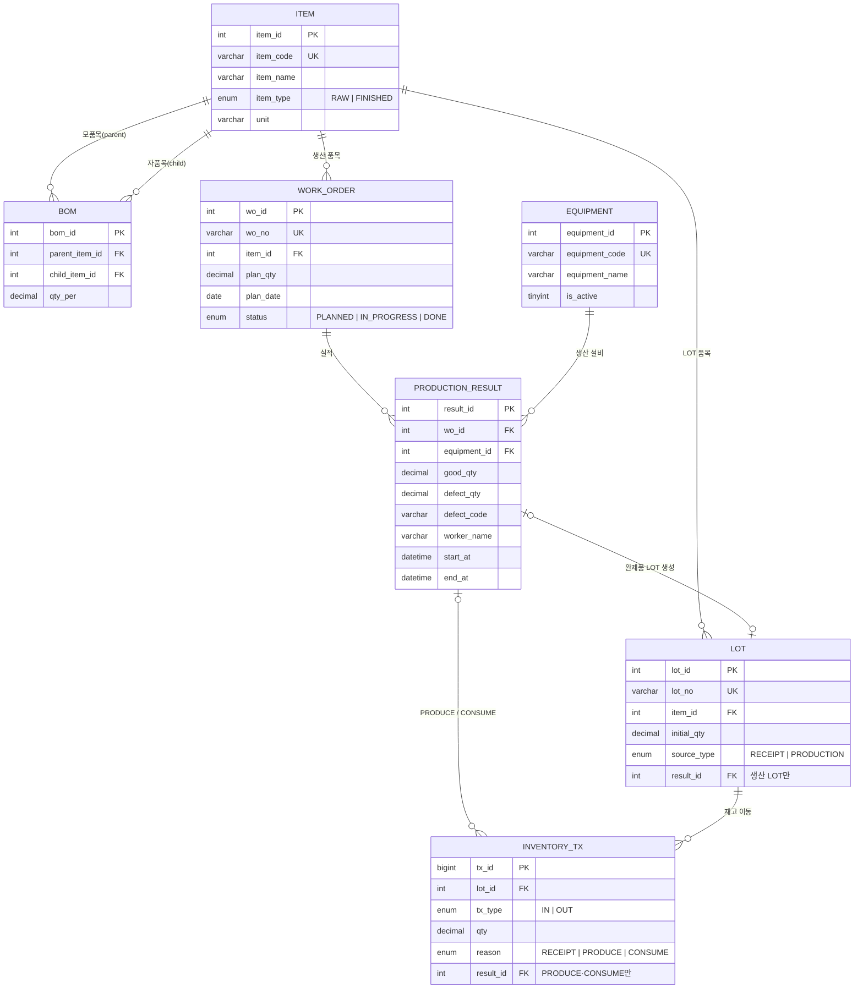

# mini-mes — 초미니 MES

볼트 가공 라인 1개짜리 가상 공장을 대상으로, MES의 기본 개념(기준정보 · 작업지시 · 생산실적 · LOT 추적 · 재고 원장)을 **테이블 7개와 REST API 15개**(+ 현장 화면 1장)로 직접 구현한 프로젝트입니다.
목표는 "데이터가 어디서 생기고 어디로 흐르는지"를 SQL 수준에서 설명할 수 있게 하는 것입니다.

- 기술 스택: MariaDB 11 · Python 3.12 · FastAPI · Pydantic v2 · SQLAlchemy 2.x Core(`text()`만, ORM 미사용) · PyMySQL · pytest · Docker Compose
- 화면: **현장 화면 `/ui`** (HTML 1장, 프레임워크 없음) + API 문서 Swagger UI(`/docs`)

---

## 1. 가상 공장

| 구분 | 내용 |
| --- | --- |
| 원자재 | 강봉 `RM-ROD` (EA), 도금액 `RM-PLATING` (L) |
| 설비 | 같은 공정의 가공기 2대 `CNC-01`, `CNC-02` |
| 완제품 | 볼트 `FG-BOLT` (EA) |
| BOM | 볼트 1EA = 강봉 1EA + 도금액 0.01L |

생산계획은 ERP에서 내려왔다고 가정하고, 작업지시부터 다룹니다.

---

## 2. 설계 원칙

1. **기준정보와 실적 데이터를 분리한다.**
   기준정보(`item`, `bom`, `equipment`)는 시드로 넣고 거의 변하지 않습니다. 실적 데이터(`work_order`, `production_result`, `lot`, `inventory_tx`)는 API 호출로만 생깁니다.
2. **재고 테이블은 없다.**
   재고 = `inventory_tx`의 IN 합계 − OUT 합계. 수량을 덮어쓰지 않고 이동 이력만 쌓기 때문에 "왜 이 재고인가"를 언제든 다시 계산·설명할 수 있습니다.
3. **모든 완제품은 LOT로 추적한다.**
   완제품 LOT → `lot.result_id`(생산실적) → 같은 실적의 CONSUME 이동 → 원자재 LOT. 별도 계보 테이블 없이 `result_id` 하나로 연결됩니다.

---

## 3. ERD



### 데이터 흐름

| 사건 | 생기는 행 |
| --- | --- |
| 원자재 입고 `POST /receipts` | `lot`(RECEIPT) 1 + `inventory_tx`(IN / RECEIPT) 1 |
| 작업지시 `POST /work-orders` → `PATCH …/start` | `work_order` 1 (PLANNED → IN_PROGRESS) |
| 실적 등록 `POST /work-orders/{id}/results` | `production_result` 1 + (양품 > 0이면) 완제품 `lot`(PRODUCTION) 1 + `inventory_tx`(IN / PRODUCE) 1 + 투입 LOT마다 `inventory_tx`(OUT / CONSUME) |
| 양품 누계 ≥ 계획수량 | `work_order.status` = DONE |

실적 등록은 **DB 트랜잭션 1개**입니다(`app/services/production.py`). 작업지시와 투입 LOT를 `SELECT … FOR UPDATE`로 잠근 뒤 상태 → 설비 → 불량코드 → LOT 존재 → BOM 품목·수량 → LOT 재고 순서로 검증하고, 하나라도 실패하면 전부 롤백합니다.

---

## 4. 실행 방법

### 준비물
- Docker Desktop (Docker Compose 포함)
- 호스트에서 테스트를 돌리려면 Python 3.12
- 호스트 포트 **3306**(DB), **8000**(API)이 비어 있어야 합니다.

### 4-1. 서버 실행

```bash
cp .env.example .env
docker compose up -d --build
```

- 처음 기동할 때 `db/migrations/001_init_schema.sql`, `002_seed_master.sql`이 자동 실행되어 테이블 7개와 기준정보가 들어갑니다.
- 상태 확인: `docker compose ps` 에서 db가 `healthy`, api가 `Up`이면 준비 완료. (api가 막 `Up`이 된 직후 1~2초는 응답하지 않을 수 있습니다.)

### 4-2. 화면 열기

| 주소 | 용도 |
| --- | --- |
| <http://localhost:8000/ui> | **현장 화면**: 사용자 입장에서 입고 → 작업지시 → 실적 입력 → 조회 |
| <http://localhost:8000/docs> | API 문서 (Swagger UI): API를 하나씩 직접 호출 |
| <http://localhost:8000/health> | 헬스 체크 |

#### 현장 화면 사용 순서 (7장 시나리오를 화면으로)

1. **① 원자재 입고**: 강봉 1200 입고 → 도금액 20 입고. 오른쪽 표에 LOT과 남은 재고가 나옵니다.
2. **② 작업지시**: 볼트, 계획 수량 1000, 계획일 오늘 → [작업지시 생성] → 목록에서 [시작] → [실적 입력 →]
3. **③ 실적 입력**: 설비 CNC-01, 작업자, 양품 480, 불량 20, 불량 코드 SCRATCH
   - 양품·불량을 입력하면 BOM 기준 소요량(강봉 500, 도금액 5)이 투입 LOT에 자동으로 채워집니다. 투입 합계가 맞으면 ✓, 아니면 ✗로 표시됩니다.
   - 한 원자재를 여러 LOT에서 나눠 쓰려면 [+ LOT 추가]를 누릅니다.
   - [실적 등록] → 완제품 LOT 번호와 작업지시 상태가 표시됩니다.
4. 같은 화면에서 CNC-02, 양품 520, 불량 10, DIMENSION 등록 → 작업지시가 완료(DONE)됩니다.
5. **④ 조회**: 재고 · 양품률 확인, 완제품 LOT 버튼을 눌러 추적 결과를 봅니다.

업무 규칙에 어긋나는 입력(불량 코드 누락, 재고 부족, BOM 수량 불일치 등)은 화면에 에러 코드와 메시지가 그대로 표시되며, 데이터는 저장되지 않습니다(롤백).

### 4-3. 테스트 실행

테스트는 호스트에서 실행하며, 위에서 띄운 DB 컨테이너에 별도의 테스트 DB `mini_mes_test`를 만들어 사용합니다. (운영 DB `mini_mes`는 건드리지 않습니다.)

```bash
python3.12 -m venv .venv
source .venv/bin/activate
pip install -r requirements.txt
pytest
```

- 테스트 세션 시작 시 `mini_mes_test`를 DROP/CREATE 하고 마이그레이션을 실행합니다(이때 `.env`의 `MARIADB_ROOT_PASSWORD` 사용).
- 각 테스트 전에 실적 테이블 4개를 비웁니다.

### 4-4. 데모 데이터 (한 달 운영한 회사처럼 채우기)

빈 DB 대신 "직원 100여 명 회사가 한 달 동안 사용한" 상태로 보고 싶으면 데모 데이터를 넣습니다. (4-3의 가상환경이 필요합니다.)

```bash
.venv/bin/python scripts/seed_demo.py --yes
```

| 항목 | 내용 |
| --- | --- |
| 기간 | 어제까지 31일. 평일 주·야 2교대, 토요일 주간만, 일요일 휴무 |
| 기준정보 | 품목 13종(완제품 7: 볼트 3규격·너트 2규격·와셔 2규격 / 원자재 6), 설비 8대(CNC 4·탭핑기 2·프레스 2) |
| 사람 | 생산직 4개 조 × 24명. 실적에 작업자 95명 안팎이 기록됨 |
| 규모 | 작업지시 약 90건(완료·진행 중·다음 근무일 계획), 생산실적 약 760건, LOT 약 810개, 재고 이동 약 2,400건 |
| 현실감 | 오전 원자재 입고·재주문점, 선입선출 투입(LOT 경계에서 2개 LOT 분할), 설비별 불량률 차이(노후 CNC-04), 셋업 불량, 설비 고장 2일, 가끔 긴급 입고 |

- 실적 테이블 4개를 비우고 다시 만듭니다(기준정보는 추가만). 난수 시드가 고정이라 같은 날 다시 돌리면 같은 데이터가 나옵니다.
- 과거 날짜로 기록해야 해서 API 대신 SQL로 넣고, 넣은 뒤 정합성 10가지를 자동 검증합니다(재고 음수 없음, BOM 수량, 작업지시 상태, 번호 순번 등).
- 출고 기능이 없는 설계라 완제품 재고는 한 달 생산량만큼 계속 쌓여 있습니다.
- 데모 데이터가 있는 상태에서는 5장 시나리오의 정답(재고 170 등)이 그대로 나오지 않습니다. 시나리오를 따라 하려면 `docker compose down -v` 후 다시 띄워 빈 DB로 시작하세요.

### 4-5. 정리

```bash
docker compose down        # 컨테이너만 중지·삭제 (데이터 유지)
docker compose down -v     # DB 볼륨까지 삭제 (다음 기동 시 시드부터 다시)
```

---

## 5. 테스트 시나리오와 정답

`tests/test_scenario.py`가 아래 순서를 API만으로 처음부터 실행하고 정답을 검증합니다. `/docs`에서 직접 따라 해 볼 수도 있습니다. (`<오늘>` = 실행일 `YYYYMMDD`)

| 순서 | API 호출 | 기대 결과 |
| --- | --- | --- |
| 1 | `POST /receipts` (RM-ROD, 1200) | lot `RM-<오늘>-001` |
| 2 | `POST /receipts` (RM-PLATING, 20) | lot `RM-<오늘>-002` |
| 3 | `POST /work-orders` (FG-BOLT, 1000, 오늘) | status PLANNED |
| 4 | `PATCH /work-orders/{id}/start` | status IN_PROGRESS |
| 5 | `POST /work-orders/{id}/results`: CNC-01, 양품 480, 불량 20(SCRATCH), 강봉 500 + 도금액 5 | product_lot `FG-<오늘>-001`, wo_status IN_PROGRESS |
| 6 | `POST /work-orders/{id}/results`: CNC-02, 양품 520, 불량 10(DIMENSION), 강봉 530 + 도금액 5.3 | product_lot `FG-<오늘>-002`, wo_status DONE |

5번 요청 본문 예시 (시드 기준 id: 강봉 LOT=1, 도금액 LOT=2, CNC-01=1):

```json
{
  "equipment_id": 1,
  "good_qty": "480",
  "defect_qty": "20",
  "defect_code": "SCRATCH",
  "worker_name": "김작업",
  "start_at": "2026-11-16T09:00:00",
  "end_at": "2026-11-16T12:00:00",
  "inputs": [
    {"lot_id": 1, "qty": "500"},
    {"lot_id": 2, "qty": "5"}
  ]
}
```

**정답**

| 조회 | 결과 |
| --- | --- |
| `GET /inventory` | RM-ROD **170**, RM-PLATING **9.7**, FG-BOLT **1000** |
| `GET /reports/yield?by=equipment` | CNC-01 **96.0**, CNC-02 **98.1** |
| `GET /reports/yield?by=work_order` | 해당 작업지시 **97.1** |
| `GET /lots/FG-<오늘>-001/trace` | 설비 CNC-01, 투입 = 강봉 `RM-<오늘>-001` 500, 도금액 `RM-<오늘>-002` 5 |

> 원자재 소요량은 양품이 아니라 **투입량(양품 + 불량)** 기준입니다.
> 예: 6번은 (520 + 10) × 0.01 = 도금액 5.3L

---

## 6. API 목록

| # | 메서드 · 경로 | 설명 |
| --- | --- | --- |
| 1 | `POST /items` | 품목 등록 |
| 2 | `GET /items` | 품목 목록 |
| 3 | `POST /boms` | BOM 등록 (모품목 FINISHED, 자품목 RAW) |
| 4 | `GET /items/{item_id}/bom` | 자품목 목록 (item_code, item_name, unit, qty_per) |
| 5 | `POST /equipment` | 설비 등록 |
| 6 | `GET /equipment` | 설비 목록 |
| 7 | `POST /receipts` | 원자재 입고 → LOT 생성 (RAW 품목만) |
| 8 | `POST /work-orders` | 작업지시 생성 (FINISHED 품목만, status PLANNED) |
| 9 | `GET /work-orders?status=` | 작업지시 목록 (status 선택 필터) |
| 10 | `PATCH /work-orders/{wo_id}/start` | PLANNED → IN_PROGRESS |
| 11 | `POST /work-orders/{wo_id}/results` | 생산실적 등록 → `result_id`, `product_lot_no`(양품 0이면 null), `wo_status` |
| 12 | `GET /inventory` | 품목별 재고 |
| 13 | `GET /lots/{lot_no}/trace` | 완제품 LOT 추적 |
| 14 | `GET /reports/yield?by=equipment\|work_order` | 그룹별 양품·불량·양품률 |
| 15 | `GET /lots?item_type=&in_stock=` | LOT 목록과 LOT별 남은 재고 (현장 화면의 투입 LOT 선택용) |

- 생성 API는 `201`, 조회·상태 변경은 `200`을 반환합니다.
- 수량은 `Decimal`이며 JSON 응답에서는 문자열(`"170.0000"`)로 나옵니다.

### 번호 규칙
| 대상 | 형식 | 날짜 기준 |
| --- | --- | --- |
| 원자재 LOT | `RM-YYYYMMDD-001` | 입고일 |
| 완제품 LOT | `FG-YYYYMMDD-001` | 실적 등록일 |
| 작업지시 | `WO-YYYYMMDD-001` | plan_date |

순번은 같은 접두어·날짜의 기존 건수 + 1이며, UNIQUE 제약 위반 시 1회 재시도합니다.

### 에러 응답

업무 에러는 모두 같은 형식입니다.

```json
{"detail": {"code": "INSUFFICIENT_STOCK", "message": "LOT RM-20261116-001 재고 부족 (남은 170.0000, 요청 500.0000)"}}
```

| code | HTTP | 언제 |
| --- | --- | --- |
| NOT_FOUND | 404 | 대상 id·코드 없음 |
| DUPLICATE_CODE | 409 | item_code, equipment_code, BOM, 번호 중복 |
| WO_INVALID_STATUS | 409 | 상태 전이 규칙 위반 (PLANNED·DONE에 실적, IN_PROGRESS를 다시 start 등) |
| DEFECT_CODE_REQUIRED | 400 | defect_qty > 0인데 defect_code 없음 |
| BOM_ITEM_MISMATCH | 400 | 투입 LOT 품목이 BOM에 없거나, BOM 원자재 중 빠진 것이 있음 |
| BOM_QTY_MISMATCH | 400 | 원자재별 투입 합계 ≠ qty_per × (양품 + 불량) |
| INSUFFICIENT_STOCK | 409 | 투입 LOT의 남은 재고 < 투입량 |
| INVALID_ITEM_TYPE | 400 | 입고에 FINISHED 품목, 작업지시에 RAW 품목 등 |

입력 형식 오류(음수, 누락, 양품+불량=0, 종료 ≤ 시작 등)는 Pydantic 기본 `422`입니다.

---

## 7. 폴더 구조

```
mini-mes/
├── docker-compose.yml       # db(mariadb:11) + api
├── Dockerfile
├── requirements.txt
├── .env.example
├── pytest.ini
├── scripts/seed_demo.py     # 운영 DB 데모 데이터 (한 달 운영)
├── db/migrations/
│   ├── 001_init_schema.sql  # 테이블 7개
│   └── 002_seed_master.sql  # 기준정보 (품목 3, BOM 2, 설비 2)
├── app/
│   ├── main.py              # 앱, 라우터 등록, 에러 핸들러
│   ├── db.py                # engine, 요청별 connection
│   ├── errors.py            # BusinessError
│   ├── schemas.py           # Pydantic 요청·응답 모델
│   ├── static/index.html    # 현장 화면 (/ui)
│   ├── routers/             # items, equipment, receipts, work_orders, reports
│   └── services/
│       ├── lot_no.py        # 번호 생성
│       └── production.py    # 실적 등록 트랜잭션
└── tests/
    ├── conftest.py          # 테스트 DB 생성·초기화, TestClient
    ├── test_master.py       # 기준정보·입고·작업지시
    ├── test_results.py      # 실적 등록 검증 실패·롤백
    └── test_scenario.py     # 시나리오 정답 검증, LOT 목록·화면
```

---

## 8. 범위 밖 항목

지금은 만들지 않았습니다.

- ERP 기능(수주, 구매 발주, 원가, 회계) — 생산계획은 ERP에서 내려왔다고 가정
- 설비 PLC 실시간 연동
- 다중 공정 라우팅, 공정 간 재공(WIP)
- 로그인·권한
- 실적 수정·삭제·취소
- 프론트엔드 프레임워크·빌드 도구 (HTML 1장 `/ui` + Swagger UI `/docs`로 대체)

## 9. 확장 계획

| 순서 | 확장 | 추가 |
| --- | --- | --- |
| 1 | 불량코드 표준화 | `defect_code` 테이블 |
| 2 | 공정 라우팅 | `process`, `routing` 테이블 |
| 3 | 실적 취소 | 반대 방향 `inventory_tx` (삭제 없는 정정) |
| 4 | 설비 데이터 수집 | `equipment_reading` 테이블 (시뮬레이션) |
| 5 | 불량 예측 | `production_result` + `equipment_reading` 피처 분류 모델 |
